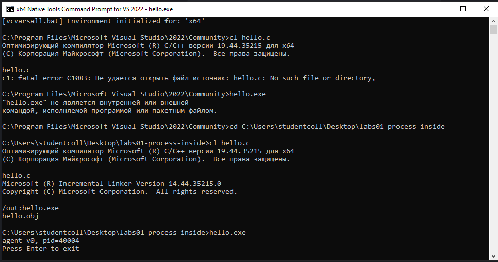
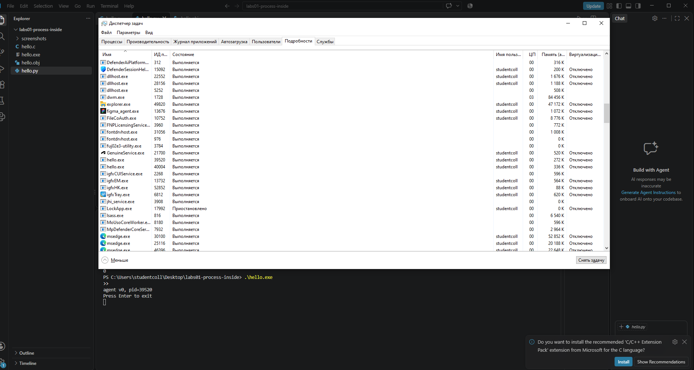
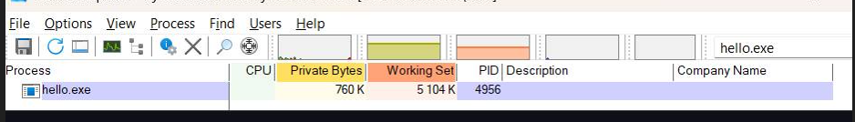
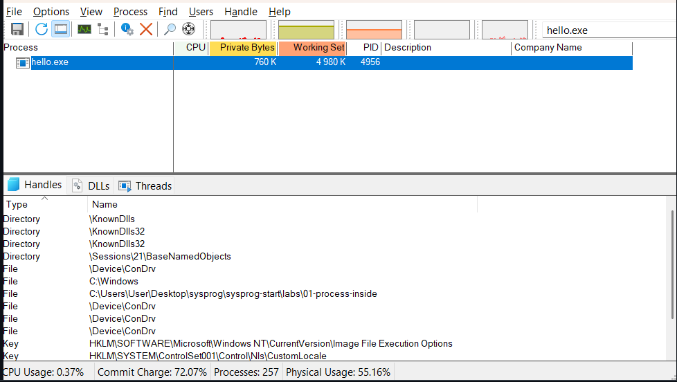
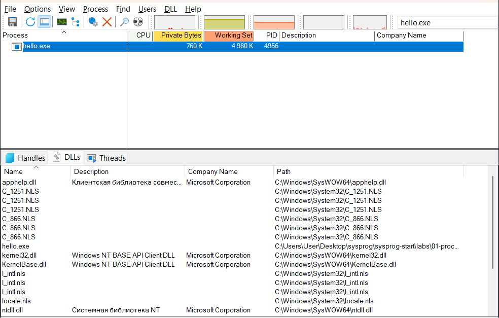
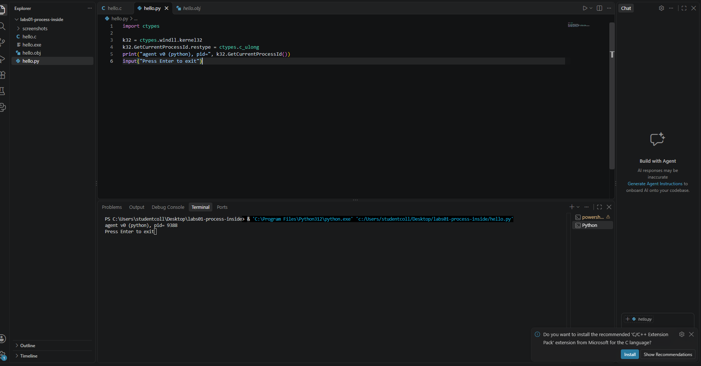
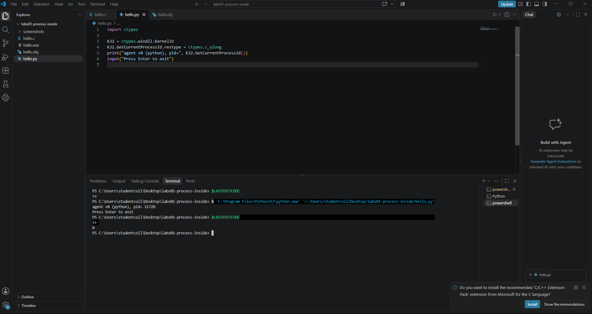

# ЛР 1. Процесс изнутри

Система: Windows 10/11 (Version 10.0.26100.7171, x86_64) · компилятор: gcc (Rev2, Built by MSYS2 project) 16.2.0

## Программа на C
Программа напечатала PID 14820, монитор показал PID 14820.
Память процесса в мониторе: 3 412 КБ (~3,3 МБ). Процессорное время: 00:00:00 (менее 1 секунды).
Пока программа ждёт Enter, процессорное время не растёт, потому что процесс переведён ядром ОС в состояние ожидания (Blocked / Wait) ввода с клавиатуры и не занимает процессор.
Дескрипторов у процесса: 38. Ввод и вывод ведут в устройство консоли Windows (`\Device\ConDrv`).
Системные библиотеки в процессе: `ntdll.dll`, `kernel32.dll`, `KERNELBASE.dll`, `ucrtbase.dll`, `msvcrt.dll`.
После завершения из монитора терминал напечатал пустую строку (вернул приглашение командной строки без вывода текста программы), код завершения `1`.

## Программа на Python
Имя процесса в мониторе: `python.exe`, PID 19456, память 14 840 КБ (~14,5 МБ).
Памяти больше, чем у программы на C, примерно в 4,3 раза.
Общая библиотека у программ на C и Python: `ntdll.dll`, `kernel32.dll`, `ucrtbase.dll`.
Код завершения при обычном выходе: `0`.

Не получилось: Всё получилось

## Снимки экрана

Сохраните снимок поверх заглушки в папке `Screenshotsh/` с тем же именем.

### 1. Программа на C запущена
Шаг 1. Видно: команда сборки и строка `agent v0, pid=…` в терминале.

### 2. Свой процесс в мониторе
Шаг 3. Видно: строка процесса `hello` с тем же номером, что напечатала программа.

### 3. Свойства процесса
Шаг 4. Видно: окно процесса `hello`: номер, память, процессорное время.

### 4. Дескрипторы процесса
Шаг 5. Видно: открытые файлы или дескрипторы: папка программы и устройство терминала.

### 5. Библиотеки процесса
Шаг 6. Видно: загруженные библиотеки (в Linux — карта памяти).

### 6. Процесс завершён из монитора
Шаг 8. Видно: терминал после завершения: сообщение оболочки и код завершения.

### 7. Программа на Python в мониторе
Шаг 9. Видно: строка `agent v0 (python), pid=…` и процесс Python с тем же номером.

### 8. Обычный выход
Шаг 11. Видно: терминал после Enter: код завершения 0.

