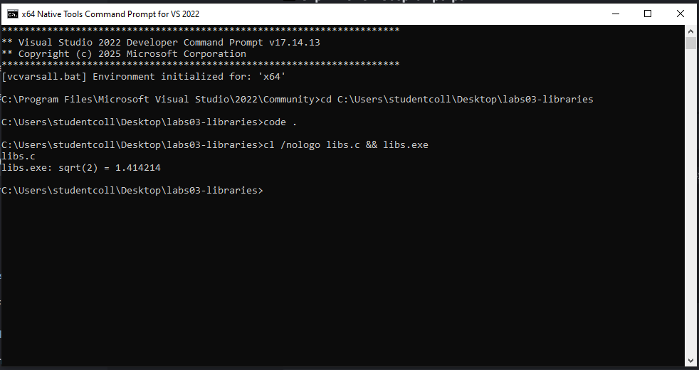
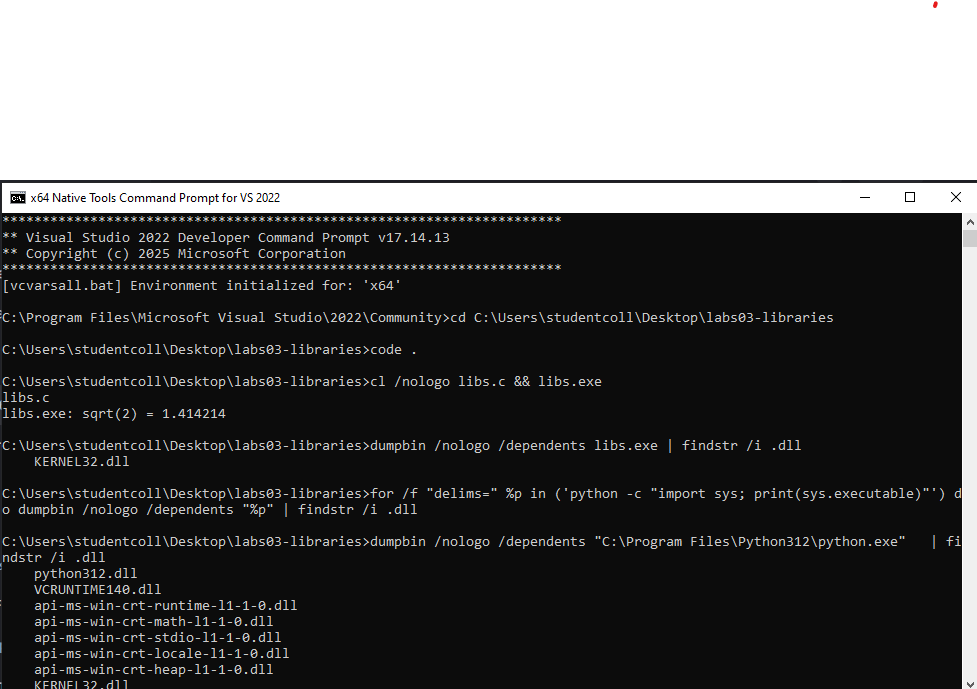
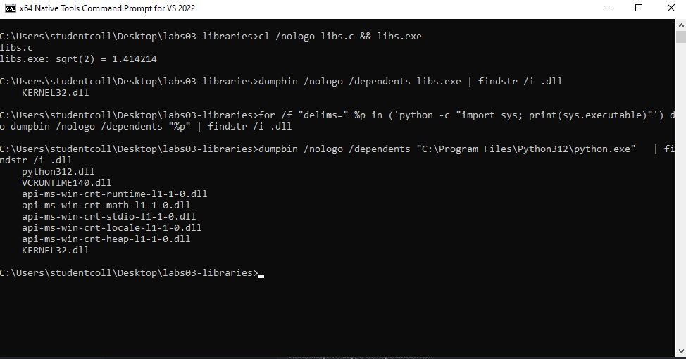
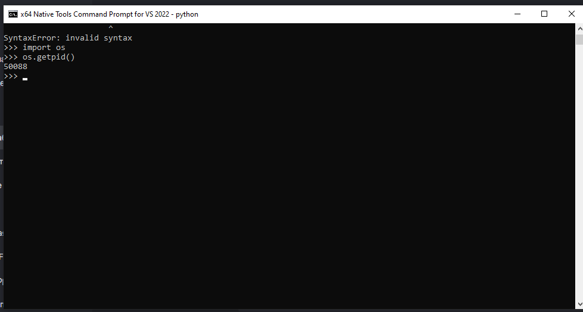
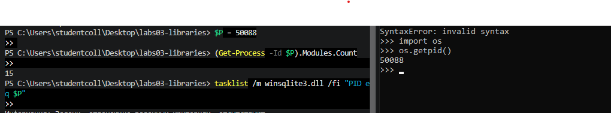
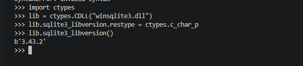
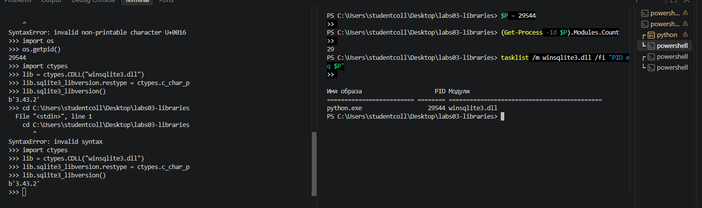

# ЛР 3. Библиотеки программы

Система: Windows 10 x64, компилятор MSVC (cl.exe из состава Visual Studio 2022)

## Библиотеки файла
Программа напечатала: `libs.exe: sqrt(2) = 1.414214`
Команда для списка библиотек файла: `dumpbin /nologo /dependents libs.exe | findstr /i .dll`
Библиотеки libs: `KERNEL32.dll`
Почему в списке нет отдельной математической библиотеки (или почему она есть): Компилятор MSVC по умолчанию собирает программу со статической библиотекой C. Код функций printf и sqrt копируется прямо в файл libs.exe при сборке, поэтому отдельной математической библиотеки в списке динамических зависимостей нет.
Где лежит интерпретатор Python (файл или библиотека): Файл `python.exe` — это маленькая обёртка, а весь интерпретатор вынесен в динамическую библиотеку `python312.dll`, которая подгружает стандартную библиотеку C Windows (VCRUNTIME140.dll и api-ms-win-crt-...).

## Библиотеки процесса
PID Python: `29544`
Библиотек в процессе до ctypes.CDLL: `15`, после: `29`
Загруженная библиотека и её полный путь: `winsqlite3.dll` (находится в системной папке `C:\Windows\System32\winsqlite3.dll`)
Функция вернула: `b'3.43.2'`

Не получилось: Ошибки синтаксиса (SyntaxError и InvalidArgument) из-за случайной вставки кода в неверные типы консолей (попытка использовать синтаксис cmd `%P%` в оболочке PowerShell и выполнение команд Python прямо в PowerShell). Проблемы решены переключением терминалов и адаптацией синтаксиса переменных под PowerShell ($P).

## Снимки экрана

Сохраните снимок поверх заглушки в папке `screenshots/` с тем же именем — ссылки ниже менять не нужно.

### 1. Сборка и запуск
Шаг 1. Видно: команда сборки и строка `sqrt(2) = 1.414214`.

### 2. Библиотеки файла libs
Шаг 2. Видно: вывод `dumpbin /dependents` / `otool -L` / `ldd` для своей программы.

### 3. Библиотеки интерпретатора Python
Шаг 3. Видно: тот же вывод для файла Python.

### 4. Номер процесса Python
Шаг 4. Видно: запущенный Python и его номер процесса.

### 5. Библиотеки процесса до загрузки
Шаг 5. Видно: число библиотек процесса Python до `ctypes.CDLL`.

### 6. Библиотека загружена
Шаг 6. Видно: строка `ctypes.CDLL` и результат вызова функции библиотеки.

### 7. Библиотеки процесса после загрузки
Шаг 7. Видно: новое число библиотек и строка загруженной библиотеки.

