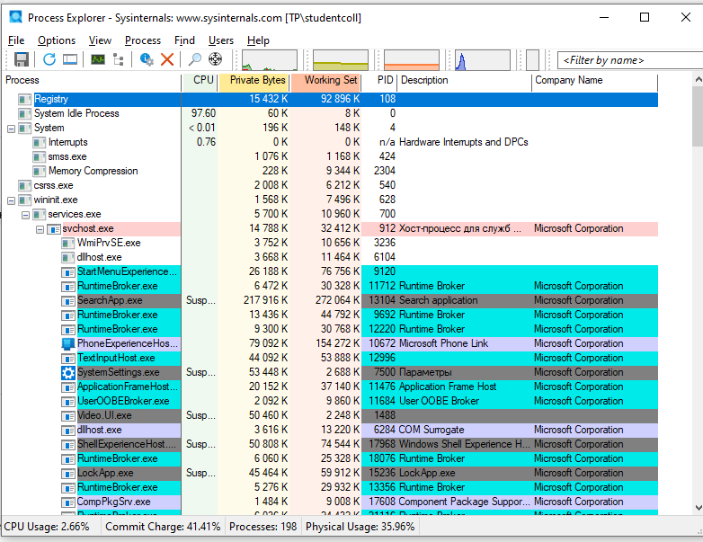
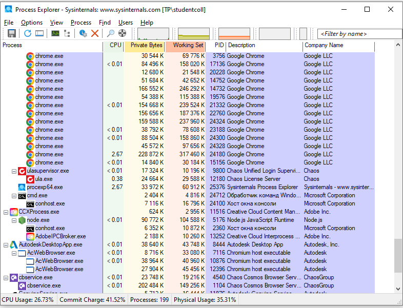
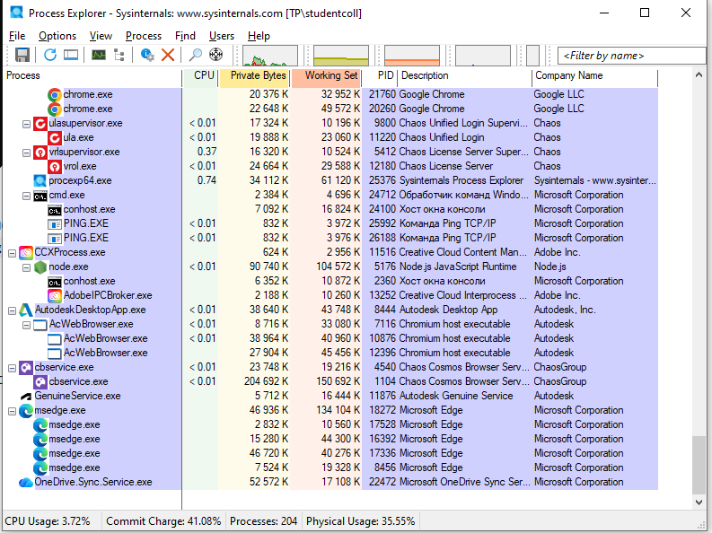
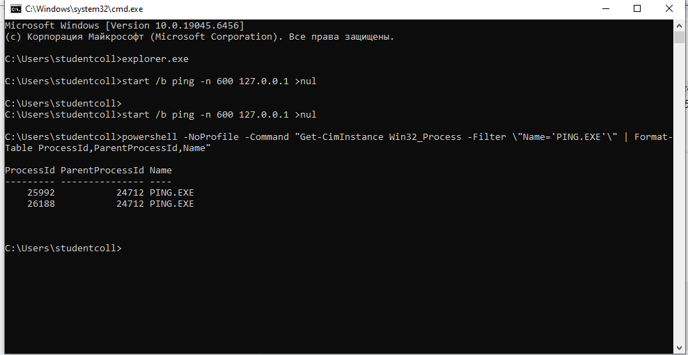
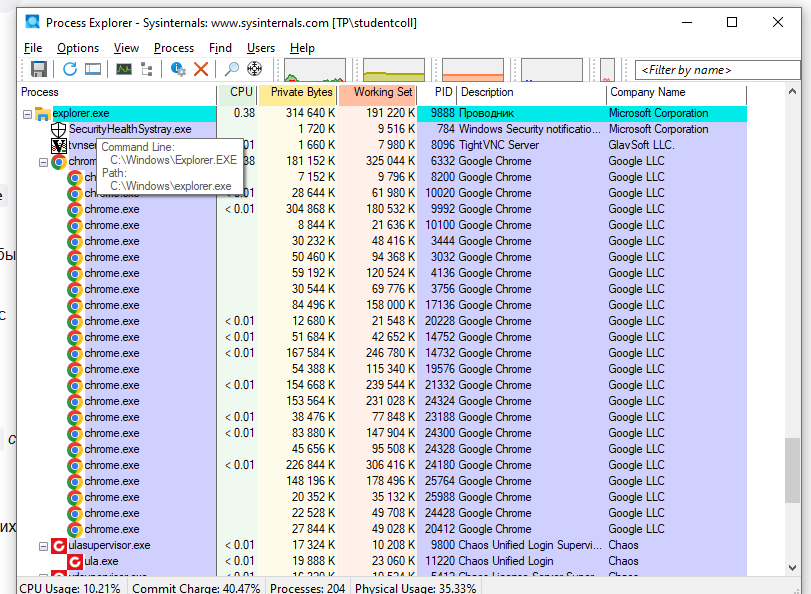
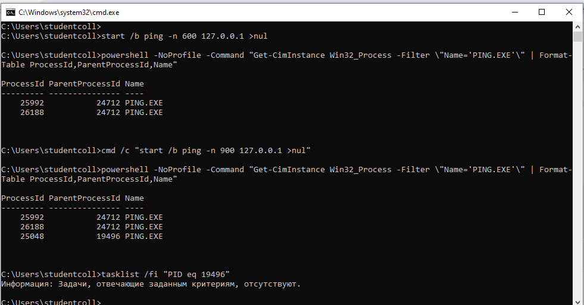
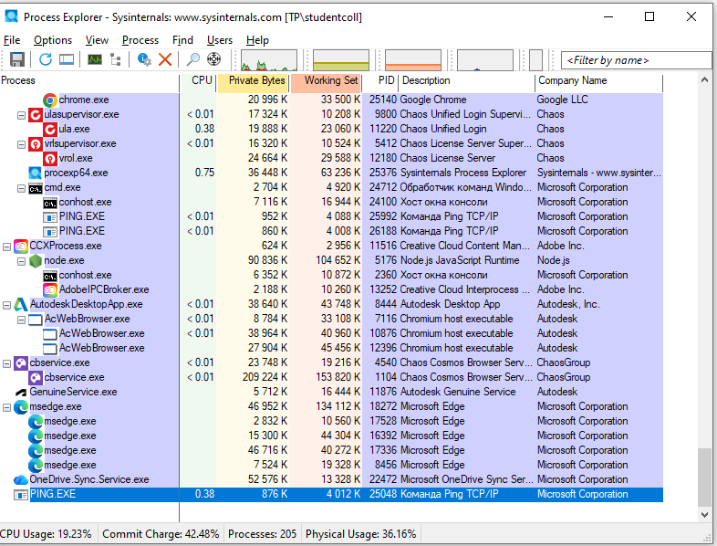

# ЛР 4. Дерево процессов

Система: Windows 10

## Дерево
Процесс в начале дерева и его номер: System Idle Process (0), System (4)
Цепочка родителей терминала (имя и номер): explorer.exe (9888) -> cmd.exe (24712) -> conhost.exe (24100)
Дочерний процесс: номер 25992, родитель 24712
Команда, которой проверен родитель: Get-CimInstance Win32_Process -Filter "Name='PING.EXE'" | Format-Table ProcessId,ParentProcessId,Name
Процессов у браузера и имя процесса вкладок: 23 процесса (1 главный и 22 дочерних), имя процесса вкладок — chrome.exe

## Сирота
Номер сироты: 25048
Номер родителя до и после завершения настоящего родителя: до — 19496, после — остался 19496 (Windows не меняет номер родителя в записи процесса, хотя процесса с таким PID уже нет)
Где сирота стоит в дереве: у самого левого края списка (без сдвига вправо), так как его родитель в списке отсутствует

Не получилось: всё получилось

## Снимки экрана

Сохраните снимок поверх заглушки в папке `screenshots/` с тем же именем — ссылки ниже менять не нужно.

### 1. Начало дерева процессов
Шаг 1. Видно: дерево процессов в мониторе: первые процессы системы и их номера.

### 2. Терминал и его родители
Шаг 2. Видно: ветка дерева от процесса терминала вверх до процесса системы.

### 3. Дочерний процесс терминала
Шаг 3. Видно: запущенный из терминала процесс под оболочкой терминала.

### 4. Родитель по команде
Шаг 4. Видно: вывод команды с номером процесса и номером его родителя.

### 5. Процессы браузера
Шаг 5. Видно: раскрытая ветка браузера с дочерними процессами.

### 6. Процесс без родителя
Шаг 6. Видно: команда запуска и номер родителя у оставшегося процесса.

### 7. Сирота в дереве
Шаг 7. Видно: тот же процесс в дереве монитора на новом месте.

