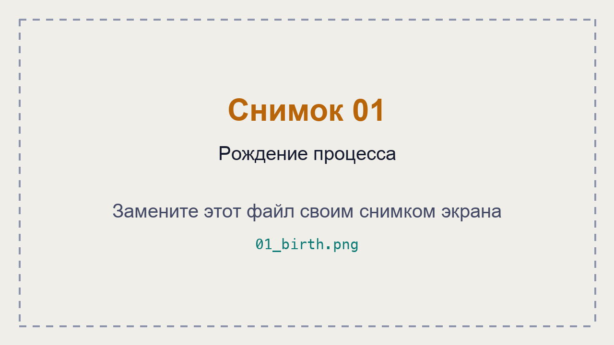
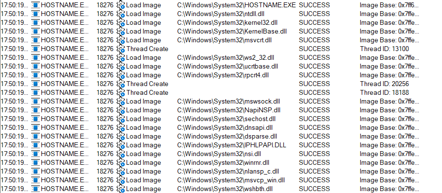
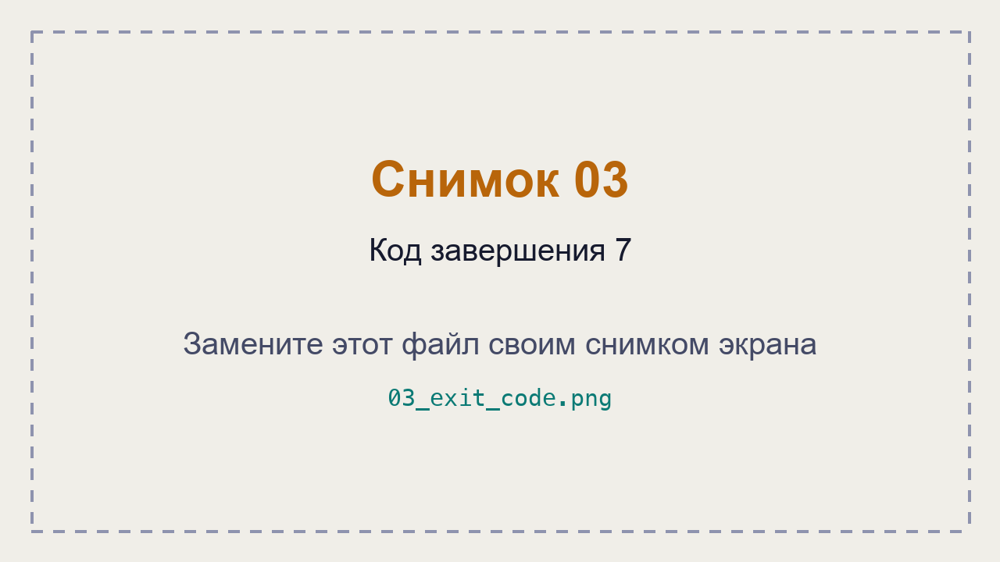
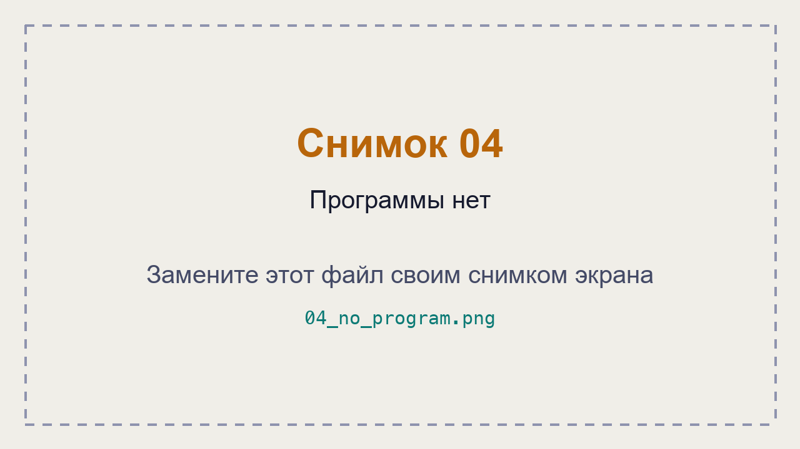
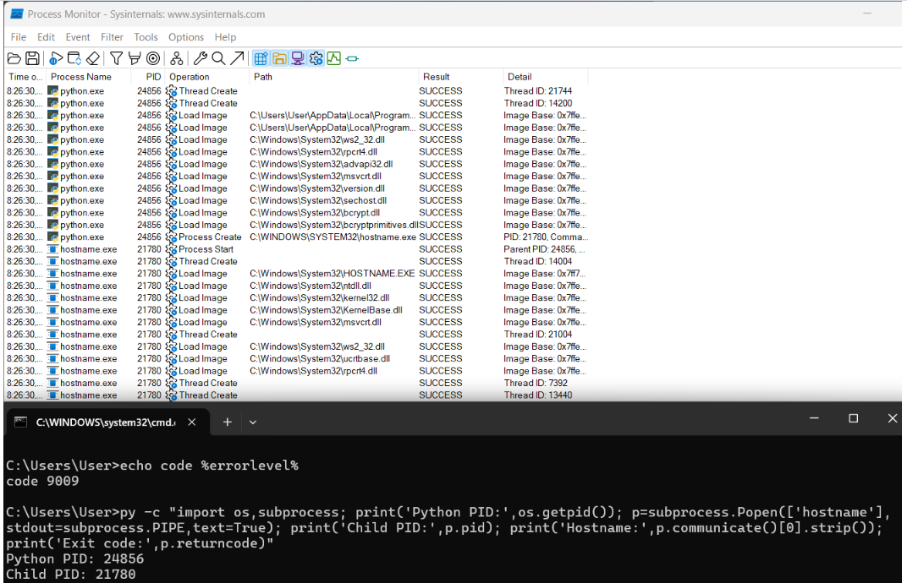

# ЛР 5. Рождение процесса

Система: Windows 10/11 (x86_64) | Программа записи: Process Monitor (`Procmon64.exe`)

## Рождение
* **Родитель (имя и номер):** `cmd.exe` (PID 1988)
* **Номер нового процесса:** `HOSTNAME.EXE` (PID 804)
* **Событие создания:** Системный вызов `CreateProcessW` (`Process Create` у родителя и `Process Start` с указанием `Parent PID: 1988` у дочернего процесса).
* **Библиотеки:** Загружено 18 образов (`Load Image`), первым идёт сам исполняемый файл `HOSTNAME.EXE`, а первой системной библиотекой — `ntdll.dll` (далее `kernel32.dll`, `KernelBase.dll` и др.).

## Завершение
* **Код завершения:** `7` (у дочернего процесса в событии `Process Exit` / `Exit Status: 7`, у родителя — в переменной `%errorlevel%`).
* **Программа `nosuch`:** Проверено 11 папок (текущая и 10 из переменной `PATH`), результат: ошибка `NO SUCH FILE` (код `2` / `ERROR_FILE_NOT_FOUND`), код оболочки `9009`.

## Запуск из Python
* **PID процессов:** `python.exe` (PID 8364) и дочерний `hostname.exe` (PID 1492).
* **Особенности:** Функция `subprocess.run` инициирует тот же системный вызов `CreateProcessW`, дожидаясь завершения дочернего процесса и перехватывая код возврата.
* **Результат:** Всё получилось.

## Снимки экрана

### 1. Рождение процесса

### 2. Библиотеки нового процесса

### 3. Код завершения 7

### 4. Программы нет

### 5. Запуск из Python

