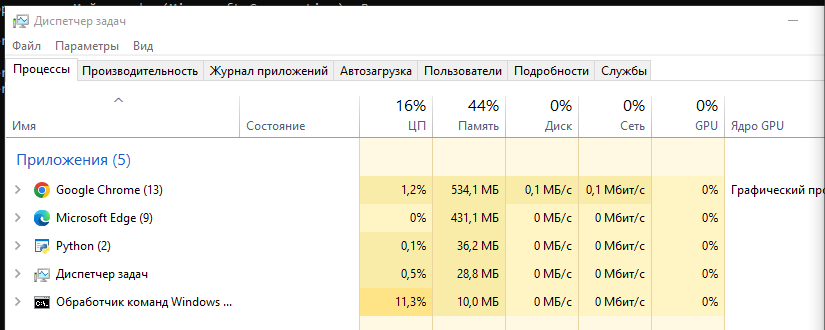
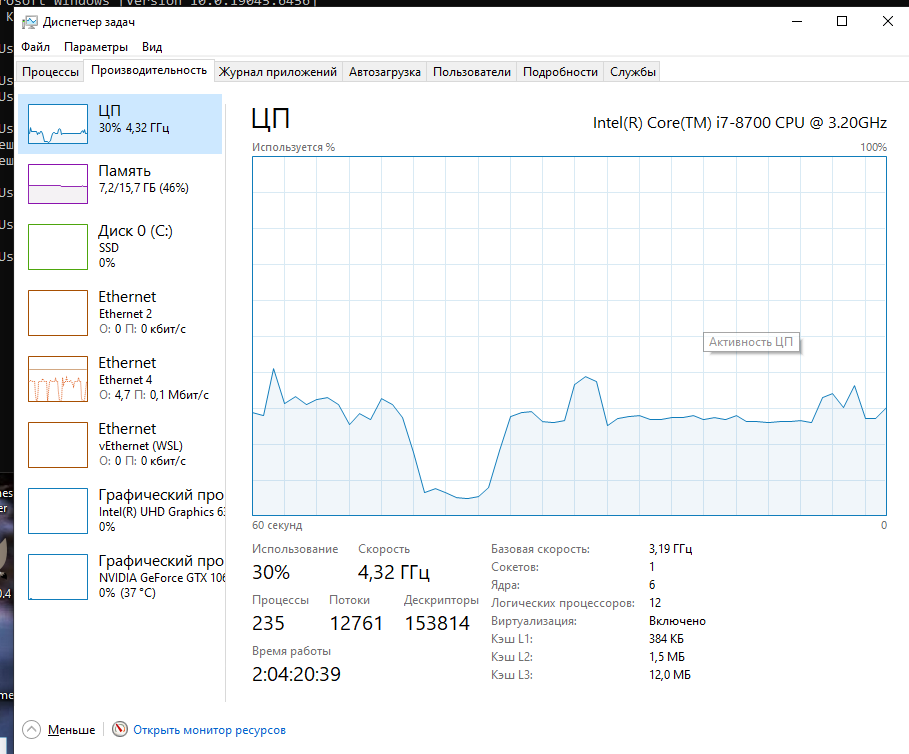
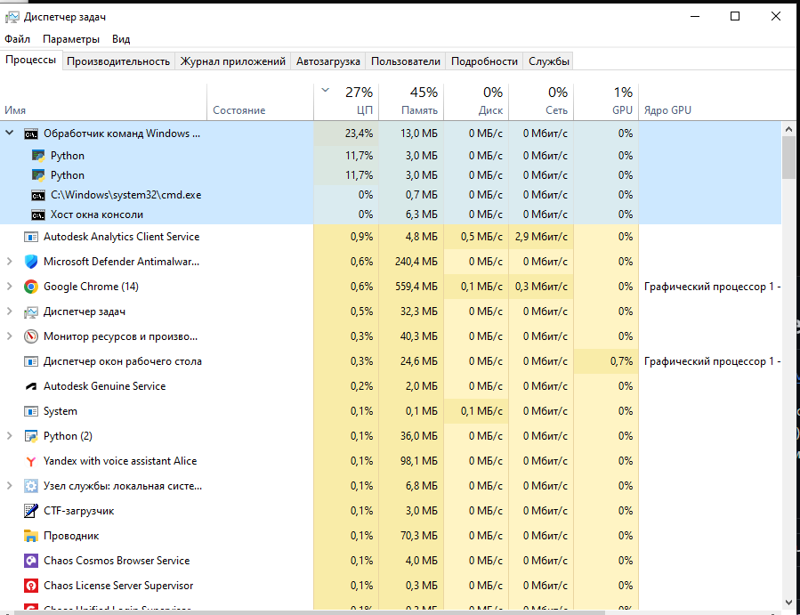
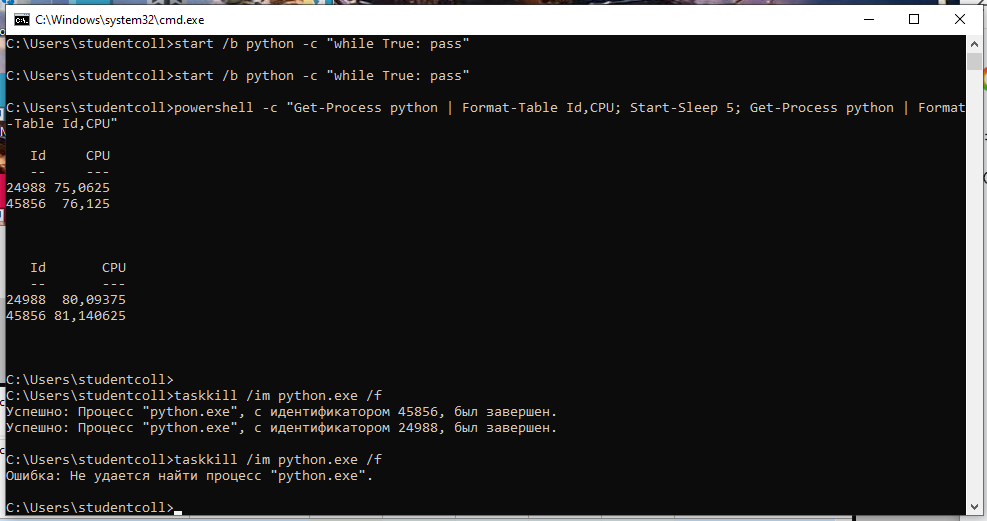

# ЛР 6. Кто загружает процессор

Система: Windows 10 (Intel Core i7-8700)
Ядер (логических процессоров): 12 (6 физических ядер)

## Одна нагрузка
Процент процесса в мониторе: ~11,3% (занимает 1 логическое ядро из 12)
Общая загрузка: 16%
На каких ядрах видна нагрузка: нагрузка распределяется по разным ядрам, программа не сидит на одном месте — планировщик Windows постоянно переносит её с ядра на ядро

## Две нагрузки
Проценты обеих нагрузок и общая загрузка: по ~11,7% на каждый процесс (в сумме ~23,4%), общая загрузка системы — 27–30%
На одном ядре (в macOS — фоновый режим): при привязке к ядру 0 (`/affinity 1`) ядро 0 загружено на 100%, а оба процесса делят его пополам (примерно по половине одного ядра на каждый), остальные ядра простаивают

## Процессорное время
Первый замер, второй замер, пауза: для процесса 24988 — 75,0625 с и 80,09375 с (прирост 5,03125 с); для процесса 45856 — 76,125 с и 81,140625 с (прирост 5,015625 с); пауза между замерами — 5 с
Загрузка по замерам: ~100% одного ядра на каждый процесс (5,03125 / 5 ≈ 100,6% и 5,015625 / 5 ≈ 100,3%), что составляет по ~8,4% от общей шкалы из 12 логических процессоров
Почему процент в мониторе не говорит о скорости работы: процент показывает только долю времени, в течение которого ядро было занято программой, но не учитывает частоту и производительность самого ядра (на медленном ядре за то же время при тех же 100% загрузки программа сделает в несколько раз меньше операций)

Не получилось: всё получилось, все шаги выполнены успешно

## Снимки экрана

Сохраните снимок поверх заглушки в папке `screenshots/` с тем же именем — ссылки ниже менять не нужно.

### 1. Одна нагрузка
Шаг 1. Видно: процесс Python в мониторе: его процент и общая загрузка.

### 2. Две нагрузки
Шаг 3. Видно: два процесса Python и загрузка ядер.

### 3. Нагрузки на одном ядре
Шаг 4. Видно: две нагрузки на одном ядре и их проценты; в macOS — два числа оборотов цикла.

### 4. Процессорное время
Шаг 5. Видно: два замера процессорного времени с паузой между ними.

