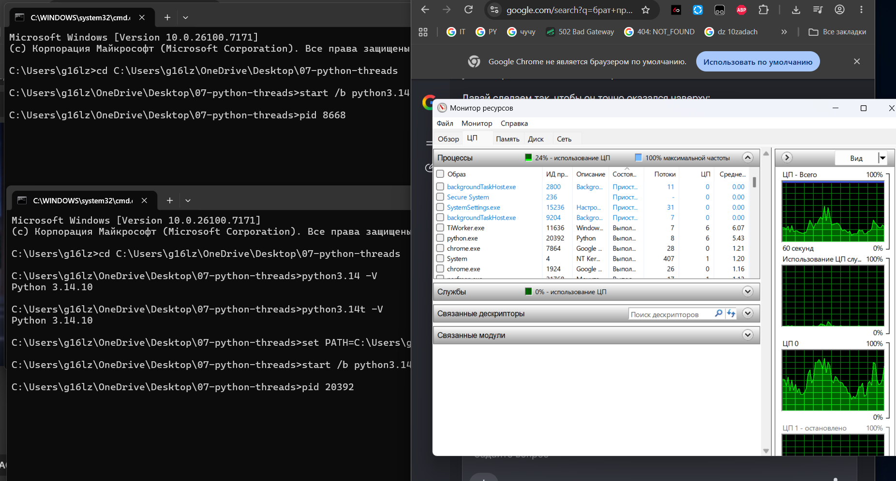
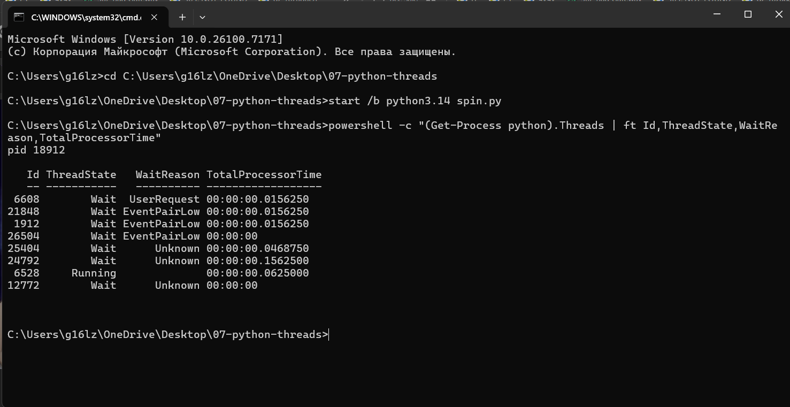
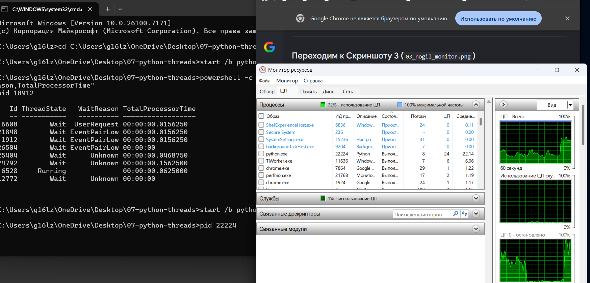
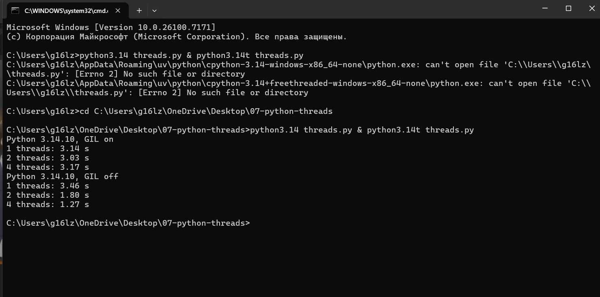

# ЛР 7. Потоки Python и GIL
Система: Windows 10/11 (Version 10.0.26100.7171)
Ядер (логических процессоров): 16
Версии Python (обычный и без GIL): Python 3.14.10 и Python 3.14.10 (freethreaded / no-GIL)

## Python с GIL
Процент процесса и число потоков: 6% ЦП (одно ядро из 16), 8 потоков
Сколько потоков выполняется одновременно: 1 поток (Running), остальные 7 ждут (Wait)

## Python без GIL
Процент процесса и проценты потоков: 24% ЦП (четыре ядра из 16, в 4 раза выше), все 4 рабочих потока выполняются одновременно на отдельных ядрах

## Время работы
С GIL, 1 / 2 / 4 потока: 3.14 с / 3.03 с / 3.17 с (ускорения нет)
Без GIL, 1 / 2 / 4 потока: 3.46 с / 1.80 с / 1.27 с (4 потока быстрее одного в 2.72 раза)
Без GIL с PYTHON_GIL=1: 3.45 с / 3.44 с / 3.46 с (ускорение снова пропадает)
Ожидание, 1 и 4 потока: 2.00 с и 2.00 с
Почему ожидающие потоки ускоряются и с GIL: Поток, который ждёт (спит или ждёт сеть/диск), сам отдаёт GIL. Пока он ждёт, замок по очереди забирают другие потоки, поэтому все ожидания идут одновременно.

Не получилось: Всё получилось

## Снимки экрана
Сохраните снимок поверх заглушки в папке `screenshots/` с тем же именем — ссылки ниже менять не нужно.

### 1. Четыре потока с GIL
Шаг 1. Видно: процесс Python в мониторе: его процент и число потоков.

### 2. Потоки процесса
Шаг 2. Видно: список потоков процесса: сколько выполняется, сколько ждёт.

### 3. Четыре потока без GIL
Шаг 3. Видно: процесс python3.14t в мониторе: его процент.

### 4. Время работы
Шаг 4. Видно: вывод threads.py в Python с GIL и без.

