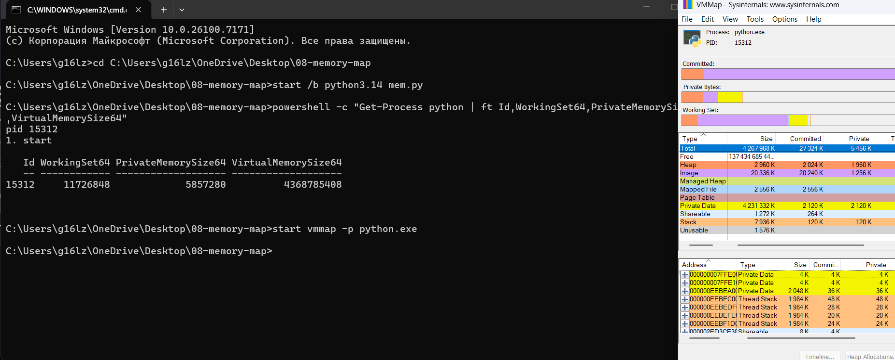
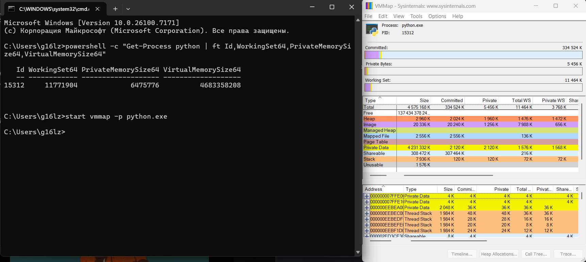
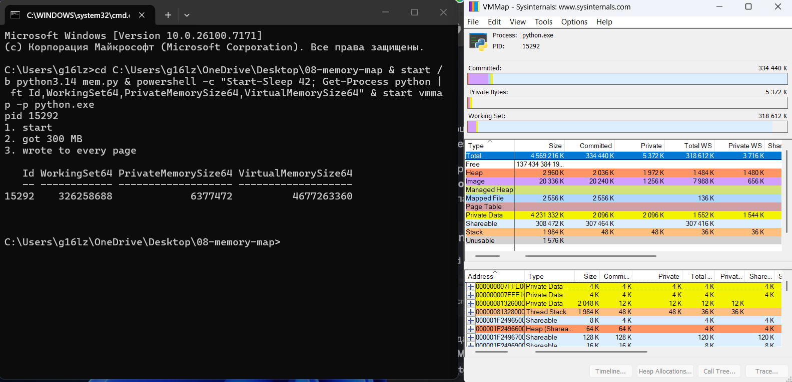
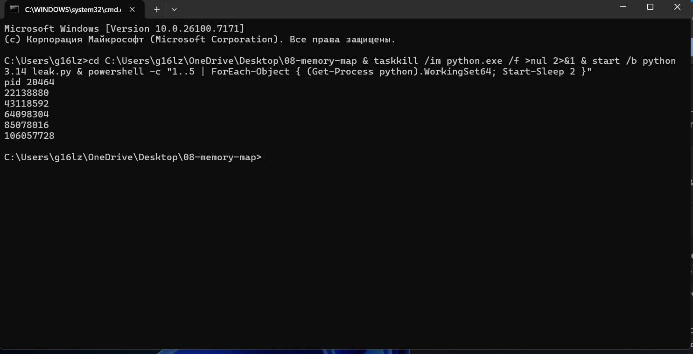

# ЛР 8. Карта памяти
Система: Windows 10/11 (Version 10.0.26100.7171, x86_64)
Инструменты: VMMap 3.4, PowerShell, командная строка, Python 3.14.10

## Три вопроса о памяти процесса
Сколько выделено, но не используется: Около 4,06 ГБ виртуального пространства (VirtualMemorySize64 ~4 368 МБ), из которых реально занято в оперативной памяти (WorkingSet64) всего ~11,2 МБ.
Почему общая сумма областей больше занятой: Потому что виртуальные адреса только зарезервированы (или обещаны/Committed ~27 МБ), а физические страницы оперативной памяти (Working Set) выделяются ядром ОС лениво — только при реальном обращении к ним.
Что будет при попытке читать чужой адрес: Произойдёт аппаратное исключение (нарушение прав доступа / Access Violation / Segmentation Fault), и операционная система немедленно аварийно завершит процесс.

## Ленивое выделение (`mem.py`)
1. Старт — занято и обещано: WorkingSet64 = 11 726 848 байт (~11,2 МБ), VirtualMemorySize64 = 4 368 785 408 байт (~4,07 ГБ), Committed = 27 332 КБ.
2. Запросили 300 МБ — занято и обещано: WorkingSet64 = 11 771 904 байт (~11,2 МБ), VirtualMemorySize64 = 4 683 358 208 байт (~4,36 ГБ, выросло на 300 МБ), Committed = 334 524 КБ.
3. Записали в каждую страницу — занято и обещано: WorkingSet64 = 326 258 688 байт (~311,1 МБ, выросло на 300 МБ), VirtualMemorySize64 = 4 677 263 360 байт (~4,36 ГБ), Committed = 334 440 КБ.
4. Освободили — занято и обещано: WorkingSet64 = 11 722 752 байт (~11,2 МБ), VirtualMemorySize64 = 4 362 690 560 байт (~4,06 ГБ), Committed = 27 232 КБ.
Почему на шаге 2 физическая память не выросла: Ядро Windows только пометило 300 МБ в таблице страниц как доступные (Committed), но не стало тратить реальные кадры ОЗУ, пока программа не начала в них писать. При первой записи на шаге 3 сработали страничные прерывания (page faults), и система выдала физические страницы.

## Поиск утечки (`leak.py`)
Пять замеров памяти: 22 138 880 байт (~21,1 МБ), 43 118 592 байт (~41,1 МБ), 64 098 304 байт (~61,1 МБ), 85 078 016 байт (~81,1 МБ), 106 057 728 байт (~101,1 МБ).
На сколько растёт за шаг и за секунду: Растёт на ~20 979 712 байт (ровно 20 МБ) за один шаг (каждые 2 секунды), то есть скорость утечки составляет ~10 МБ/с.

Не получилось: Всё получилось

## Снимки экрана
Сохраните снимок поверх заглушки в папке `screenshots/` с тем же именем — ссылки ниже менять не нужно.

### 1. Карта памяти на старте
Шаг 1. Видно: карта памяти процесса `mem.py` на старте и её итог.

### 2. После запроса 300 МБ
Шаг 2. Видно: виртуальная память выросла на 300 МБ, занятая — нет.

### 3. После записи в каждую страницу
Шаг 3. Видно: занятая память выросла на 300 МБ.

### 4. Поиск утечки
Шаг 4. Видно: пять замеров памяти `leak.py`.

