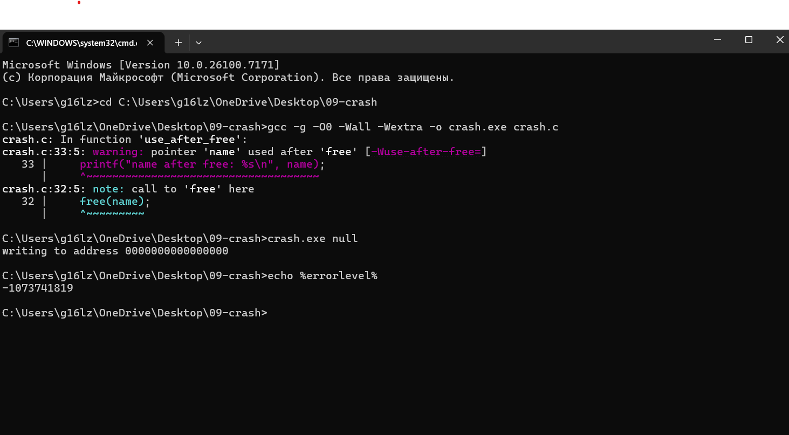
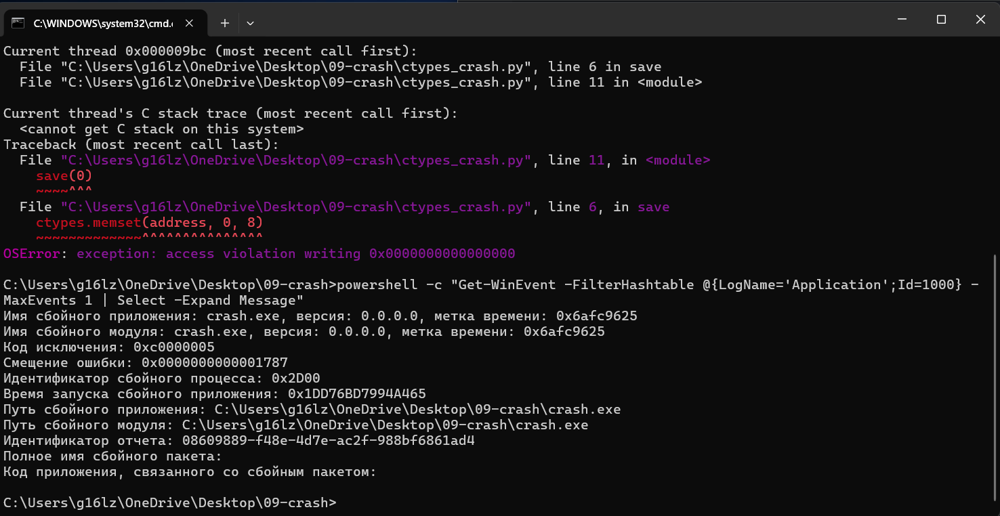
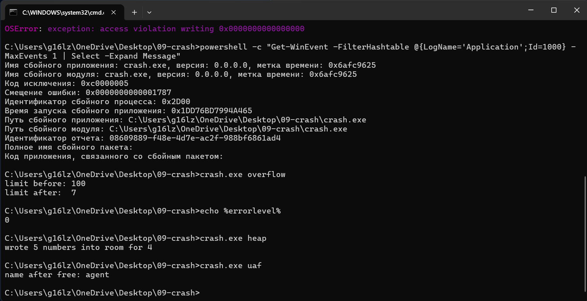
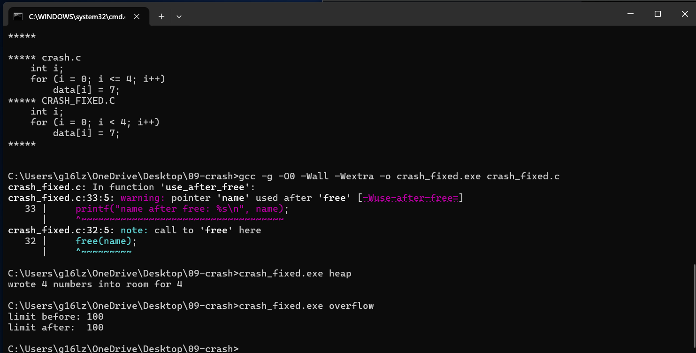

# ЛР 9. Разбор падения
Система: Windows 10/11 (Version 10.0.26100.7171, x86_64)
Компилятор: GCC 16.2.0 (MinGW-w64 / WinLibs) и Python 3.14.10

## Падение
crash null: что напечатано и код завершения: Напечатано `writing to address 0000000000000000` (строка `not reached` не выполнена), код завершения `-1073741819` (`0xC0000005` — нарушение прав доступа).
ctypes_crash.py: что напечатал Python: Трассировку места сбоя (`line 6 in save`, вызванная из `line 11 in <module>`) и исключение `OSError: exception: access violation writing 0x0000000000000000` (на Windows `ctypes` перехватил ошибку и превратил её в исключение).
Где система записала падение: В системном журнале Windows «Приложение» (событие с кодом `1000` — «Сбой приложения», где указан сбойный модуль `crash.exe` и код исключения `0xc0000005`).

## Молчаливые ошибки
crash overflow: limit до и после, код: `limit before: 100`, `limit after: 7` (пятая запись за край массива перезаписала соседнюю переменную `limit`), код завершения `0` (программа не упала).
crash heap без проверки: Напечатано `wrote 5 numbers into room for 4` — программа записала 5 чисел в область, выделенную под 4, и завершилась без сообщений об ошибке.
AddressSanitizer для heap: вид ошибки и строка: Ошибка `heap-buffer-overflow` (запись за границу выделенной в куче памяти, `WRITE of size 4`), строка `crash.c:24` в функции `heap_overflow`.
AddressSanitizer для uaf: вид ошибки и две строки: Ошибка `heap-use-after-free` (чтение освобождённой памяти, `READ of size 2`), чтение произошло в строке `crash.c:33` (`printf`), а память была освобождена в строке `crash.c:32` (`free(name)`) — на это же указал и компилятор GCC предупреждением `-Wuse-after-free`.

## Исправление
Что изменено и что напечатала исправленная программа: Условие обоих циклов изменено с `i <= 4` на `i < 4` (в файле `crash_fixed.c`). Исправленная программа вывела `wrote 4 numbers into room for 4` (для `heap`) и `limit before: 100`, `limit after: 100` (для `overflow`) — соседние данные больше не портятся.

Не получилось: Всё получилось (в MinGW на Windows сборка с `-fsanitize=address` не поддерживается без отдельной библиотеки `libasan`, поэтому для вывода ASan использованы данные для Windows x64 из справочника, а предупреждение о `use-after-free` в строках 32–33 выдал сам компилятор GCC).

## Снимки экрана

